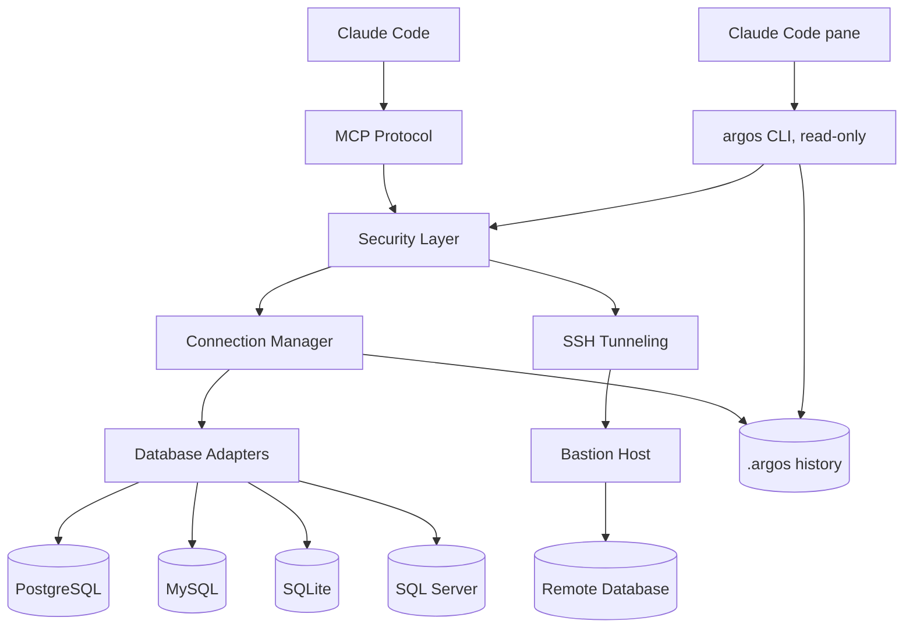

<div align="center">

# Argos

**A hundred eyes on your databases, and none of them blink: beside Claude Code, and in front of every query it runs.**

[](https://github.com/AraneaDev/argos/releases)
[](https://aranea-development.nl/en/tools/argos)
[](https://github.com/AraneaDev/argos/actions/workflows/ci.yml)
[](https://github.com/AraneaDev/argos/actions/workflows/ci.yml)
[](./LICENSE)
[](https://github.com/AraneaDev/argos)
[](https://github.com/AraneaDev/argos/commits/main)
[](https://www.conventionalcommits.org/)
[](https://mcpobservatory.com/servers/github:AraneaDev/argos/security)
[](#installation)

</div>

> **Argos Panoptes** (Ἄργος Πανόπτης) is the giant of Greek myth with a hundred eyes, set by
> Hera to guard Io. Only some of his eyes slept at a time, so he was never fully asleep and
> nothing passed him unseen. *Panoptes* means "all-seeing".

**TL;DR:** Argos lets Claude Code query PostgreSQL, MySQL, SQLite and SQL Server through one
MCP server. Every request passes validation, access controls and redaction, and leaves an audit
record, before it reaches the database. In Claude Code, `/argos` opens a pane beside your
session: your connections and their schema, every query Claude runs with its full result, and
an editor for your own queries, which are always read-only.

Argos speaks any MCP client, not just Claude Code, and connects to databases you already run,
directly or through an SSH tunnel.

> **Status:** pre-release. Argos is **not yet published to npm**, and the publish step in
> the release workflow is deliberately dormant. The source is public on
> [GitHub](https://github.com/AraneaDev/argos), so install from source (see
> [Installation](#installation)). Any `npm install -g argos-mcp` command you find elsewhere will
> not resolve yet.

---


A Claude Code session: `/argos` opening the pane, a question about the shop database whose
query lands in Queries with its full result, a look at `orders` in Schema, and the Editor
refusing a `DELETE` on a connection that allows writes.

## Features

- **The pane**: `/argos` opens your databases beside the chat on four tabs: Queries (every
  query Claude or you ran, across sessions, with its full result, pins and reruns), Schema
  (tables with their keys and relations), Editor (your own queries) and Connections
- **Pane queries are always read-only**: whatever a connection allows Claude, what you run from
  the pane opens read-only at the database where the engine supports it, behind the same
  SELECT-only check the server uses
- **SELECT-only mode**: production-safe read-only access per connection, which the model
  cannot relax from a session
- **Query validation**: bound parameters, stacked statements refused, comment- and
  literal-aware parsing, complexity limits
- **Field redaction**: emails, phone numbers and other protected columns are masked before a
  result reaches Claude, or the pane
- **Audit logging**: one record per query: database, statement hash, duration, outcome, never
  the values
- **Schema changes reach Claude**: when a connection's schema changed since Argos last looked,
  the next query says what changed, so Claude doesn't work from an old picture of the tables
- **Column names checked before a query runs**: a SELECT that names a column the cached schema
  doesn't have is not run; Claude gets a "did you mean" and the table's columns instead, and
  an unknown-name error from the database gets the same correction appended
  ([how it decides](docs/api/mcp-tools-reference.md#name-checking))
- **SSH tunnels**: encrypted connections through bastion hosts, with a pinned host key
- **Four engines**: PostgreSQL, MySQL/MariaDB (including Azure), SQLite, and SQL Server
  (including Azure SQL with passwordless sign-in through the Azure CLI)
- **Performance tools**: connection pooling, schema caching, batches with transactions, and
  EXPLAIN plans with dialect-specific advice
- **Runtime configuration**: add, update and lock connections through MCP tools, without a
  restart, and never with write access the model granted itself

## Installation

**Requirements:** Node.js >= 24.15 and the [Claude Code CLI](https://docs.claude.com/en/docs/claude-code).
Connecting to Azure SQL with `authentication=azure-cli` additionally needs the
[Azure CLI](https://learn.microsoft.com/cli/azure/install-azure-cli) on `PATH`
and a completed `az login`; nothing else does.

### 1. Build
```bash
git clone https://github.com/AraneaDev/argos.git
cd argos
npm install
npm run build
```

### 2. Configure databases
```bash
npm run setup
```
Interactive wizard for adding database connections, security settings, and SSH tunnels. It writes a `config.ini`, by convention at `~/.config/argos/config.ini`, though any path works. You can also add databases at runtime with the `sql_add_database` tool.

### 3. Register with Claude Code
```bash
claude mcp add argos --scope user -- \
  node "$(pwd)/dist/cli.js" serve --config "$HOME/.config/argos/config.ini"
```

Scopes:

| Scope | Flag | Where it lives | Use when |
|-------|------|----------------|----------|
| User | `--scope user` | `~/.claude.json` | You want Argos in every project (most common) |
| Project | `--scope project` | `.mcp.json` in the repo | You want to share it with your team via git |
| Local | *(default)* | Per-project, private | You're just trying it out |

### 4. Install the pane
```bash
node dist/cli.js install-plugin --config "$HOME/.config/argos/config.ini"            # preview
node dist/cli.js install-plugin --config "$HOME/.config/argos/config.ini" --execute  # install
```
Use the same `config.ini` you registered the server with: the pane reads the history the server
writes beside it. Start a new Claude Code session afterwards.

### 5. Verify
```bash
claude mcp list
```
You should see `argos` listed as connected. Its tools appear in Claude Code as `mcp__argos__sql_query`, `mcp__argos__sql_get_schema`, and so on, and `/argos` opens the pane.

### Removing it
```bash
claude plugin uninstall argos
claude plugin marketplace remove argos
claude mcp remove argos --scope user
```

## Quick start

Ask Claude about your data in plain words, and watch the queries land in the pane:

- *"Show me the top 10 customers by revenue this quarter, including their growth rate compared to last quarter"*
- *"How many signups in the last 24 hours, and any error patterns?"*
- *"Analyze the performance of our product catalog queries and suggest optimizations"*
- *"Generate test data scenarios based on our current user demographics"*

Claude reads the schema first, then queries; each result comes back to it as a short table,
and in full to you in the pane.

## The pane


Queries: every query Claude or you ran, newest first and kept across sessions, with the selected
one's SQL and its full result. `r` reruns it read-only, `p` pins it, `c` copies the result as
markdown, CSV or JSON, and `s` puts one of your own results into your next message to Claude.


Schema: each connection's tables and views, the open table's columns with their keys, and its
relations in and out.


Editor: type SQL against any connection and run it. A write is refused with the reason, even on
a connection that allows Claude to write.


Connections: each database with its engine, host, tunnel, access and schema age.

Every tab, key, setting and limit is in [the pane guide](docs/claude-code/pane.md).

## CLI

| Command | Description |
|---------|-------------|
| `argos serve` | Start the Argos MCP server on stdio (this is what Claude Code invokes) |
| `argos setup` | Run the interactive configuration wizard |
| `argos install-plugin` | Install the [Claude Code pane](docs/claude-code/pane.md) (preview; `--execute` to install) |
| `argos connections` | List the configured connections as JSON |
| `argos schema <db> [--refresh]` | Print a database's schema as JSON |
| `argos query <db> --sql <sql>` | Run a read-only query and record it in the history |
| `argos history`, `argos result <id>` | Page through the history and a saved result |
| `argos pin`, `argos unpin <id>`, `argos pins` | Manage pinned queries |
| `argos help` | Show usage (also what plain `argos` does) |
| `argos version` | Show the version |

The pane runs the JSON commands for you; they are there for scripts too. `argos` is exposed as a
`bin` entry, so `npm link` (or a global install) puts it on your `PATH`.

## Configuration examples

### Production PostgreSQL with SSH
```ini
[database.production]
type=postgresql
host=internal-db.company.local
port=5432
database=production_app
username=readonly_user
password=secure_random_password
ssl=true
select_only=true
timeout=15000

# SSH Tunnel Configuration
ssh_host=bastion.company.com
ssh_port=22
ssh_username=tunnel_user
ssh_private_key=/secure/path/ssh_key
# Required: without a pinned fingerprint the tunnel refuses to connect, rather
# than trusting whatever host key it is offered. Get it from the bastion with
#   ssh-keygen -lf /etc/ssh/ssh_host_ed25519_key.pub
ssh_host_fingerprint=SHA256:47DEQpj8HBSa+/TImW+5JCeuQeRkm5NMpJWZG3hSuFU

[security]
max_joins=5
max_subqueries=3
max_complexity_score=50
```

### Azure SQL without a password

The Azure CLI's own sign-in is the credential, so no secret is written to
`config.ini` at all.

```ini
[database.azure_sql]
type=mssql
host=your-server.database.windows.net
port=1433
database=your_database_name
authentication=azure-cli
select_only=true

# Only when the server's tenant is not the CLI's active context, which is the
# usual case for an account with access to several tenants. Must be the GUID.
# azure_tenant_id=00000000-0000-0000-0000-000000000000
```

Needs `az login` beforehand, and the signed-in identity mapped as a database
user: `CREATE USER [you@company.com] FROM EXTERNAL PROVIDER;`. Encryption and
certificate verification are forced on for this mode, because an access token is
a bearer credential and an unverified connection hands it to whoever answers.

See the [SQL Server guide](docs/databases/sql-server.md#azure-cli-authentication)
for the details, including unattended use.

### Azure Database for PostgreSQL without a password

The same Azure CLI sign-in works for Azure Database for PostgreSQL. The Entra
access token is the password, fetched fresh for every new connection because it
is valid for 5 to 60 minutes.

```ini
[database.azure_pg]
type=postgresql
host=your-server.postgres.database.azure.com
port=5432
database=your_database_name
username=argos-readers
authentication=azure-cli
select_only=true
# azure_tenant_id=00000000-0000-0000-0000-000000000000
```

`username` is the Entra user or group as mapped in the database with
`pgaadauth_create_principal`. TLS with certificate verification is forced, for
the same reason as for Azure SQL. See the
[PostgreSQL guide](docs/databases/postgresql.md#azure-database-for-postgresql-with-azure-cli-authentication).

### Multi-Database Analytics Setup
```ini
[database.transactions]
type=postgresql
host=transactions-db.company.com
database=transactions
select_only=true

[database.users]
type=mysql
host=users-db.company.com
database=users
select_only=true

[database.analytics]
type=sqlite
file=./data/analytics.sqlite
select_only=false

[database.local_cache]
type=sqlite
file=./data/cache.sqlite
select_only=false
mcp_configurable=true

[extension]
max_rows=1000
query_timeout=30000
```

## Safety model

1. **Query validation**: SQL injection prevention and syntax analysis
2. **Complexity limits**: resource-intensive queries are refused
3. **SELECT-only mode**: Argos refuses anything but a read. The filter is a second net: the
   database role is the boundary, so for a `select_only` database Argos asks the database
   once per connection whether its role can write, and warns in `sql_test_connection`,
   `sql_list_databases` and the pane when it can. Set `require_readonly_role=true` to refuse
   such a connection instead
4. **Read-only pane**: what you run from the pane opens read-only at the database (SQLite
   read-only mode, a read-only PostgreSQL or MySQL session) behind the SELECT-only check; SQL
   Server has no session-level equivalent and relies on the check. The
   [pane guide](docs/claude-code/pane.md#pane-queries-are-always-read-only) says exactly what
   each engine guarantees
5. **Connection encryption**: SSL/TLS and SSH tunnel support
6. **Audit logging**: comprehensive security event tracking
7. **[Field redaction](docs/features/field-redaction.md)**: automatic masking of sensitive data in query results

### Field Redaction

Automatically mask, replace, or partially obscure sensitive fields (emails, phone numbers, SSNs, etc.) in query results before they reach Claude, the pane, or other clients. Redaction is configured per-database in `config.ini`:

```ini
[database.production]
type=postgresql
host=prod-db.company.com
database=app_db
username=readonly_user
password=secure_pass
select_only=true

# Field Redaction
redaction_enabled=true
redaction_rules=*email*:partial_mask,*phone*:full_mask,ssn:replace:[PROTECTED]
redaction_case_sensitive=false
redaction_log_access=true
```

**Redaction types:**
| Type | Example Input | Example Output |
|------|--------------|----------------|
| `partial_mask` | `john.doe@example.com` | `j******.e@*****.com` |
| `full_mask` | `555-123-4567` | `**********` (capped at 10) |
| `replace` | `123-45-6789` | `[PROTECTED]` |
| `custom` | Regex-based | Custom pattern |

**Field patterns:** exact match (`email`), wildcard (`*email*`), or regex (`/^user_.+$/`).

**[Full Redaction Guide](docs/features/field-redaction.md)**

### What this gives you towards compliance

Argos is not certified against any standard, and no library can be. Compliance
is a property of your deployment. What it provides is the controls and the
evidence that such a regime asks for:

- Read-only enforcement that cannot be relaxed from a session
- Field redaction, so protected columns never reach the model
- An audit record per query: timestamp, database, statement hash, duration,
  outcome, with no values and no SQL
- Secrets scrubbed from logs and error messages
- Owner-only file modes on the log, the audit records, the configuration and the pane's history

The pane's history (`.argos/` beside your `config.ini`) holds query text and redacted results
for up to 30 days, so it is git-ignored and owner-only.

## Runtime database management

Argos supports runtime database management through dedicated MCP tools. This allows you to add, update, and remove database connections without restarting the server.

| Tool | Description | Requirements |
|------|-------------|--------------|
| `sql_add_database` | Add new database connections at runtime via MCP | None |
| `sql_update_database` | Update existing database settings via MCP | `mcp_configurable=true` on the target database |
| `sql_remove_database` | Remove database connections via MCP | `mcp_configurable=true` on the target database |
| `sql_get_config` | View database configuration (passwords are automatically redacted) | None |
| `sql_set_mcp_configurable` | Lock a database from MCP changes | One-way operation: can only lock (`false`), unlocking requires manual config edit |

- Set `mcp_configurable=true` in your database config to allow MCP-driven updates and removal.
- The `sql_set_mcp_configurable` tool is a one-way lock: once set to `false`, the database can no longer be modified or removed via MCP. Unlocking requires a manual edit to the configuration file.
- The `sql_get_config` tool always redacts passwords and other sensitive fields before returning configuration data.
- Databases added at runtime via `sql_add_database` have `mcp_configurable=true` by default, and are **always** `select_only=true`. Granting write access requires editing `config.ini` by hand, so the model cannot grant it to itself.

## Performance

Query time is your database's, not Argos's. It adds validation and formatting
around a normal client connection. `sql_get_metrics` reports the latency it
actually observed (min, max, avg, p95), and `sql_analyze_performance` returns the
execution plan with dialect-specific advice when something is slow.

- **Connection pooling**: reuse database connections efficiently
- **Schema caching**: captured once per database, checked cheaply for changes at most once a minute
- **Result streaming**: large result sets never fully materialise in memory
- **Batch operations**: several queries in one call, optionally in one transaction

## Architecture



The pane cannot reach the MCP server over stdio, so it runs the `argos` CLI, which reads the same
`config.ini` and history and goes through the same security, redaction and audit layers.

## Documentation

### Getting started
- **[5-Minute Quick Start](docs/guides/quick-start.md)**: get running fast
- **[Installation Guide](docs/guides/installation-guide.md)**: detailed setup instructions
- **[First Database Tutorial](docs/tutorials/02-first-database.md)**: connect your first database
- **[Claude Integration](docs/tutorials/03-claude-integration.md)**: register with Claude Code
- **[The Claude Code pane](docs/claude-code/pane.md)**: every tab, key and setting

### Architecture and design
- **[System Architecture](docs/architecture/system-architecture.md)**: how it all works together
- **[Security Architecture](docs/architecture/security-architecture.md)**: defense-in-depth security model
- **[Database Layer](docs/architecture/database-layer.md)**: adapter pattern implementation

### API reference
- **[MCP Tools Reference](docs/api/mcp-tools-reference.md)**: complete tool documentation
- **[TypeScript API](docs/api/typescript-api.md)**: developer API reference
- **[Configuration Reference](docs/guides/configuration-guide.md)**: all configuration options

### Advanced guides
- **[Multi-Database Setup](docs/tutorials/advanced-01-multi-database.md)**: managing multiple databases
- **[SSH Tunneling](docs/tutorials/advanced-02-ssh-tunnels.md)**: secure remote access
- **[Security Hardening](docs/operations/security-hardening.md)**: production security guide
- **[Performance Tuning](docs/operations/performance-tuning.md)**: optimization strategies

**[Browse all documentation](docs/README.md)**

## Development

```bash
git clone https://github.com/AraneaDev/argos.git
cd argos
npm install
npm run dev
npm test           # the server and CLI (jest)
npm run test:mod   # the Claude Code pane (vitest)
npm run validate   # everything CI runs
```

The README and pane guide images come from `node tools/capture/shoot.mjs`, which drives an
isolated Claude Code session on demo data; see `tools/capture/`.

**[Full Development Guide](docs/development/development-setup.md)**

### Layers

The source is layered, and a lower layer may never depend on a higher one:

| layer | directory | may depend on |
|---|---|---|
| `types` | `src/types` | nothing in `src` |
| `utils` | `src/utils` | `types` |
| `adapters` | `src/database` | `types`, `utils` |
| `domain` | `src/classes`, `src/schema`, `src/pane` | `types`, `utils`, `adapters` |
| `mcp-tools` | `src/tools` | everything below |
| `cli` | `src/cli`, `src/setup` | everything below, and nothing depends on it |

Nothing in `src` imports from `tests` or `examples`, and the pane (`plugin/`) imports nothing from
`src`: it talks to the CLI's JSON.

These rules are not enforced by CI. They are a design constraint, checked by
hand or by whatever analysis tool you point at the checkout, so read the table
before adding an import that reaches upward. A cycle between layers is the
signal that something belongs in a lower one.

## Migrating from Argos-MCP

The project was renamed from Argos-MCP to Argos. If you set it up before the rename:

- **Claude Code registration:** re-register under the new name so the tools appear as
  `mcp__argos__*`:

  ```bash
  claude mcp remove argos-mcp   # whatever name you registered it under
  claude mcp add argos --scope user -- \
    node /abs/path/to/argos/dist/cli.js serve --config /abs/path/config.ini
  ```

- **Commands:** `argos-mcp` is now `argos serve`, and `argos-setup` is now `argos setup`.
  The old names still work for one release and print a deprecation notice to stderr.
- **Audit logs** are now written to `~/.argos/audit/`. Earlier logs stay in
  `~/.argos-mcp/audit/`; move them over if you want one trail.
- **Server log** is now `argos.log` (was `argos-mcp.log`).
- **Repository:** `AraneaDev/Argos-MCP` is now `AraneaDev/argos`; GitHub redirects the old URL,
  but update your remote with `git remote set-url origin https://github.com/AraneaDev/argos.git`.

## Further reading

- [How to give Claude safe access to your SQL database](https://tim-schipper.nl/en/blog/claude-safe-database-access)

## License

Released under the [MIT License](./LICENSE), free for any use, commercial
included, with no warranty.

## Acknowledgments

- **[Anthropic](https://anthropic.com)**: for Claude and the MCP protocol
- **Database driver maintainers**: for reliable connectivity libraries
- Built with TypeScript, Node.js, Jest and Vitest

---

Built by [Tim Schipper](https://tim-schipper.nl/en) and released as open source under
[Aranea Development](https://aranea-development.nl).
