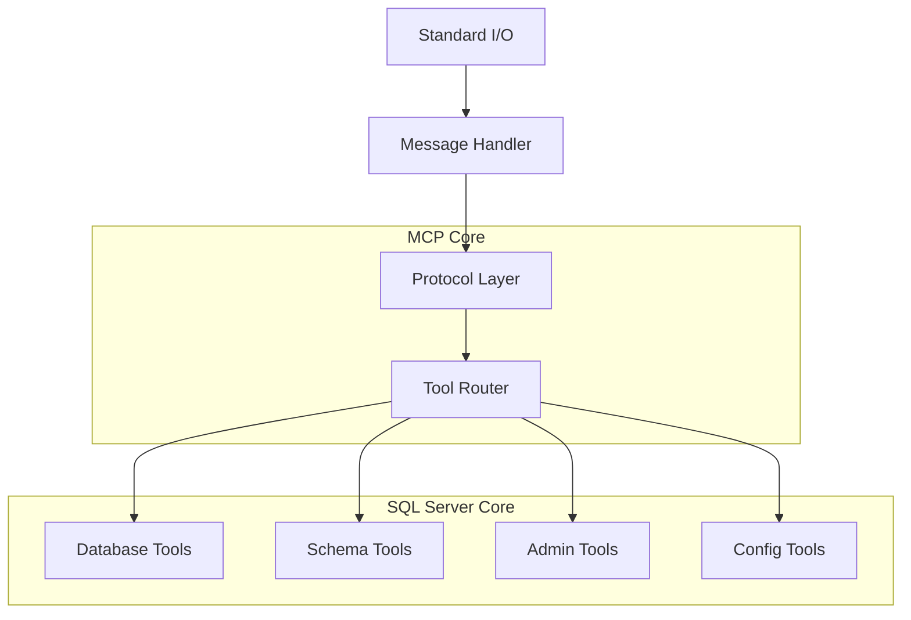

# MCP Protocol Implementation

This document details how the Argos implements the Model Context Protocol (MCP) for seamless integration with Claude Code and other MCP-compatible clients.

## Table of Contents

- [MCP Protocol Overview](#mcp-protocol-overview)
- [Protocol Implementation](#protocol-implementation)
- [Message Handling](#message-handling)
- [Tool System](#tool-system)
- [Error Handling](#error-handling)
- [Performance Optimizations](#performance-optimizations)
- [Security Considerations](#security-considerations)
- [Testing & Validation](#testing--validation)

---

## MCP Protocol Overview

### What is MCP?
The Model Context Protocol (MCP) is a standardized protocol that enables AI assistants like Claude to securely interact with external systems and data sources. It provides:

- **Structured Communication**: JSON-RPC 2.0 based messaging
- **Tool Discovery**: Dynamic tool registration and capability advertisement
- **Security**: Built-in validation and sandboxing
- **Extensibility**: Plugin architecture for custom integrations

### Protocol Specification
- **Version**: 2025-06-18
- **Transport**: stdio (standard input/output)
- **Message Format**: JSON-RPC 2.0
- **Encoding**: UTF-8

---

## Protocol Implementation

### Server Architecture
The Argos implements the complete MCP specification:



### Message Flow
1. **Client Connection**: Claude Code connects via stdio
2. **Initialization Handshake**: Server capabilities negotiation
3. **Tool Discovery**: Client requests available tools
4. **Tool Execution**: Client calls tools with parameters
5. **Response Delivery**: Server returns structured results

### Implementation Classes

#### MCPServer (SQLMCPServer)
The JSON-RPC transport, the `initialize` handshake and the message envelope are handled by
the MCP SDK (`@modelcontextprotocol/sdk`): `SQLMCPServer` registers two request handlers on
the SDK `Server` and connects it to a `StdioServerTransport`.

```typescript
export class SQLMCPServer extends EventEmitter {
 // tools/list and tools/call, as registered with the SDK
 listTools(): { tools: MCPTool[] };
 callTool(name: string, args: Record<string, unknown> | undefined): Promise<{
 content: Array<{ type: 'text'; text: string }>;
 isError: boolean;
 }>;
}
```

---

## Message Handling

### Supported Methods
The server implements all required MCP methods:

| Method | Purpose | Implementation |
|--------|---------|----------------|
| `initialize` | Server capability negotiation | Returns server info and capabilities |
| `tools/list` | Tool discovery | Returns all available SQL tools |
| `tools/call` | Tool execution | Routes to specific tool handlers |
| `notifications/initialized` | Client ready signal | Acknowledges client initialization |

> **Note:** The server now exposes **12 tools** in total: 7 original database/schema/admin tools plus 5 new configuration management tools.

### Message Processing Pipeline

```typescript
// The SDK parses each stdin message, answers initialize itself, and routes:
this.mcpServer.setRequestHandler(ListToolsRequestSchema, async () => this.listTools());
this.mcpServer.setRequestHandler(CallToolRequestSchema, async (request) =>
 this.callTool(request.params.name, request.params.arguments)
);

// callTool validates the arguments, runs the tool through the dispatcher
// (src/tools/dispatcher.ts), and turns any thrown error into an isError result
// with a sanitized message, so a failing tool never breaks the connection.
```

### Tools List Implementation
```typescript
private async handleToolsList(request: MCPRequest): Promise<MCPResponse> {
 const tools: MCPTool[] = [
 {
 name: "sql_query",
 description: "Execute a single SQL query on a configured database",
 inputSchema: {
 type: "object",
 properties: {
 database: { type: "string", description: "Database name" },
 query: { type: "string", description: "SQL query to execute" },
 params: { type: "array", items: { type: "string" }, description: "Query parameters" }
 },
 required: ["database", "query"],
 additionalProperties: false
 }
 },
 // ... other tools
 ];

 return {
 jsonrpc: '2.0',
 id: request.id,
 result: { tools }
 };
}
```

---

## Tool System

### Tool Registration Architecture
Tools are statically registered at server startup:

```typescript
interface ToolDefinition {
 name: string;
 description: string;
 inputSchema: JSONSchema;
 handler: ToolHandler;
 validator?: InputValidator;
}

type ToolHandler = (args: any) => Promise<MCPToolResponse>;
type InputValidator = (args: any) => ValidationResult;
```

### Tool Execution Pipeline
1. **Input Validation**: Validate arguments against JSON schema
2. **Security Check**: Apply security policies and restrictions
3. **Handler Execution**: Execute tool-specific logic
4. **Response Formatting**: Format results for MCP protocol
5. **Error Handling**: Convert errors to MCP error format

### Tool Implementation Example
```typescript
// sql_query tool implementation
private async handleSqlQuery(args: SQLQueryArgs): Promise<MCPToolResponse> {
 const { database, query, params = [] } = args;
 
 try {
 // 1. Validate arguments
 if (!isSQLQueryArgs(args)) {
 throw new Error("Invalid arguments for sql_query");
 }
 
 // 2. Security validation
 const dbConfig = this.getDatabaseConfig(database);
 if (dbConfig?.select_only) {
 const validation = this.securityManager.validateSelectOnlyQuery(query, dbConfig.type);
 if (!validation.allowed) {
 throw new SecurityViolationError(validation.reason!);
 }
 }
 
 // 3. Execute query
 const result = await this.connectionManager.executeQuery(database, query, params);
 
 // 4. Format response
 const responseText = this.formatQueryResponse(result, database, dbConfig);
 
 return {
 content: [{ type: "text", text: responseText }],
 _meta: { progressToken: null }
 };
 
 } catch (error) {
 return {
 content: [{ 
 type: "text", 
 text: ` Error: ${error.message}` 
 }],
 isError: true,
 _meta: { progressToken: null }
 };
 }
}
```

### Configuration Management Tools

The server includes 5 configuration management tools that allow databases to be managed dynamically via MCP:

- **`sql_add_database`** - Add a new database connection at runtime
- **`sql_update_database`** - Update an existing database connection's settings
- **`sql_remove_database`** - Remove a database connection
- **`sql_get_config`** - Retrieve the current configuration for a database
- **`sql_set_mcp_configurable`** - Enable or disable MCP configurability for a database

These tools modify the in-memory configuration and persist all changes to `config.ini`, ensuring that updates survive server restarts.

**Security model (`mcp_configurable`):** The `mcp_configurable` flag acts as a one-way lock. Once set to `false` (or omitted), a database's configuration cannot be modified through MCP tools -- it can only be changed by directly editing `config.ini`. This prevents an AI assistant from altering the configuration of sensitive databases. Setting `mcp_configurable=true` must be done explicitly in the config file or via `sql_set_mcp_configurable` while the flag is still enabled.

### Dynamic Tool Discovery
Tools can be discovered dynamically based on configuration:

```typescript
private generateToolList(): MCPTool[] {
 const tools: MCPTool[] = [];
 
 // Core tools (always available)
 tools.push(...this.getCoreTools());
 
 // Database-specific tools
 if (this.hasConfiguredDatabases()) {
 tools.push(...this.getDatabaseTools());
 }
 
 // Admin tools (if enabled)
 if (this.config?.extension?.enable_admin_tools) {
 tools.push(...this.getAdminTools());
 }
 
 return tools;
}
```

---

## Error Handling

### MCP Error Format
All errors follow JSON-RPC 2.0 error format:

```typescript
interface MCPError {
 code: number;
 message: string;
 data?: any;
}

// Standard error codes
const ERROR_CODES = {
 PARSE_ERROR: -32700,
 INVALID_REQUEST: -32600,
 METHOD_NOT_FOUND: -32601,
 INVALID_PARAMS: -32602,
 INTERNAL_ERROR: -32603
} as const;
```

### Error Response Generation
```typescript
private createErrorResponse(
 id: string | number | null, 
 code: number, 
 message: string,
 data?: any
): MCPResponse {
 return {
 jsonrpc: '2.0',
 id,
 error: { code, message, data }
 };
}
```

### Tool Error Handling
Tool errors are converted to user-friendly responses:

```typescript
private formatToolError(error: Error, toolName: string): MCPToolResponse {
 let errorMessage = ` Error in ${toolName}: ${error.message}`;
 
 // Add context-specific troubleshooting
 if (error instanceof SecurityViolationError) {
 errorMessage += '\n\n **Security Information:**\n';
 errorMessage += 'This database is configured with SELECT-only mode for safety.';
 } else if (error instanceof ConnectionError) {
 errorMessage += '\n\n **Connection Troubleshooting:**\n';
 errorMessage += '- Verify database configuration\n';
 errorMessage += '- Check network connectivity\n';
 errorMessage += '- Ensure database is running';
 }
 
 return {
 content: [{ type: "text", text: errorMessage }],
 isError: true,
 _meta: { progressToken: null }
 };
}
```

---

## Performance Optimizations

### Message Buffering
Efficient handling of streaming stdio input:

```typescript
private setupStdioHandling(): void {
 let buffer = '';
 
 process.stdin.on('data', (chunk: string) => {
 buffer += chunk;
 
 // Process complete messages
 const lines = buffer.split('\n');
 buffer = lines.pop() || ''; // Keep incomplete line
 
 for (const line of lines) {
 if (line.trim()) {
 // Process in next tick to prevent blocking
 setImmediate(() => this.handleMessage(line.trim()));
 }
 }
 });
}
```

### Response Streaming
Large responses can be streamed using progress tokens:

```typescript
private async handleLargeDataSet(
 database: string, 
 query: string
): Promise<MCPToolResponse> {
 const progressToken = generateProgressToken();
 
 // Start async processing
 this.processLargeQuery(database, query, progressToken);
 
 return {
 content: [{ 
 type: "text", 
 text: " Processing large query..." 
 }],
 _meta: { progressToken }
 };
}
```

### Connection Pooling
Reuse database connections across tool calls:

```typescript
private connectionPool = new Map<string, DatabaseConnection>();

private async getConnection(database: string): Promise<DatabaseConnection> {
 if (!this.connectionPool.has(database)) {
 const connection = await this.createConnection(database);
 this.connectionPool.set(database, connection);
 }
 
 return this.connectionPool.get(database)!;
}
```

---

## Security Considerations

### Input Validation
All tool inputs are validated against JSON schemas:

```typescript
private validateToolInput(toolName: string, args: any): ValidationResult {
 const tool = this.tools.get(toolName);
 if (!tool) {
 return { valid: false, error: 'Unknown tool' };
 }
 
 const validator = ajv.compile(tool.inputSchema);
 const valid = validator(args);
 
 if (!valid) {
 return { 
 valid: false, 
 error: 'Invalid input',
 details: validator.errors 
 };
 }
 
 return { valid: true };
}
```

### Output Sanitization
All outputs are sanitized to prevent information leakage:

```typescript
private sanitizeOutput(result: QueryResult, config: DatabaseConfig): QueryResult {
 // Limit result size
 if (result.rows.length > this.config.extension?.max_rows || 1000) {
 result.rows = result.rows.slice(0, this.config.extension?.max_rows || 1000);
 result.truncated = true;
 }
 
 // Remove sensitive fields if configured
 if (config.hide_sensitive_data) {
 result.rows = result.rows.map(row => this.removeSensitiveFields(row));
 }
 
 return result;
}
```

### Protocol Security
- **No arbitrary code execution**: Only predefined tools allowed
- **Sandboxed operations**: Database operations isolated by configuration
- **Input validation**: All inputs validated against strict schemas
- **Output limits**: Response size limits prevent resource exhaustion

---

## Testing & Validation

### Protocol Compliance Testing
The SDK owns the JSON-RPC layer, so tests call the two handler methods directly
(`tests/integration/mcp-server.test.ts`):

```typescript
describe('MCP tools', () => {
 it('should return valid tools list', () => {
 const { tools } = server.listTools();

 expect(tools.length).toBeGreaterThan(0);
 tools.forEach((tool: MCPTool) => {
 expect(tool).toHaveProperty('name');
 expect(tool).toHaveProperty('description');
 expect(tool).toHaveProperty('inputSchema');
 });
 });

 it('should execute sql_query tool successfully', async () => {
 const result = await server.callTool('sql_query', { database: 'test', query: 'SELECT 1 as test_value' });

 expect(result.isError).toBe(false);
 expect(result.content[0].text).toContain('test_value');
 });

 it('should report an unknown tool as an error result', async () => {
 const result = await server.callTool('no_such_tool', {});

 expect(result.isError).toBe(true);
 expect(result.content[0].text).toContain('Unknown tool');
 });
});
```

### Message Format Validation
```typescript
const messageSchemas = {
 request: {
 type: 'object',
 properties: {
 jsonrpc: { const: '2.0' },
 id: { type: ['string', 'number', 'null'] },
 method: { type: 'string' },
 params: { type: 'object' }
 },
 required: ['jsonrpc', 'method'],
 additionalProperties: false
 },
 
 response: {
 type: 'object',
 properties: {
 jsonrpc: { const: '2.0' },
 id: { type: ['string', 'number', 'null'] },
 result: { type: 'object' },
 error: {
 type: 'object',
 properties: {
 code: { type: 'number' },
 message: { type: 'string' },
 data: { type: 'object' }
 },
 required: ['code', 'message']
 }
 },
 required: ['jsonrpc', 'id'],
 oneOf: [
 { required: ['result'] },
 { required: ['error'] }
 ]
 }
};
```

---

## Best Practices

### Protocol Implementation
1. **Strict Compliance**: Follow MCP specification exactly
2. **Error Handling**: Provide meaningful error messages
3. **Performance**: Optimize for low latency and high throughput
4. **Security**: Validate all inputs and sanitize outputs
5. **Testing**: Comprehensive test coverage for all protocol aspects

### Tool Design
1. **Single Responsibility**: Each tool should have one clear purpose
2. **Clear Documentation**: Comprehensive descriptions and examples
3. **Input Validation**: Strict schema validation
4. **Error Recovery**: Graceful handling of edge cases
5. **Performance**: Efficient execution with reasonable timeouts

### Message Handling
1. **Async Processing**: Use async/await for all I/O operations
2. **Buffering**: Proper handling of streaming input
3. **Backpressure**: Handle high message volumes gracefully
4. **Memory Management**: Prevent memory leaks in long-running processes

This comprehensive MCP protocol implementation ensures reliable, secure, and performant integration with Claude Code and other MCP-compatible clients.