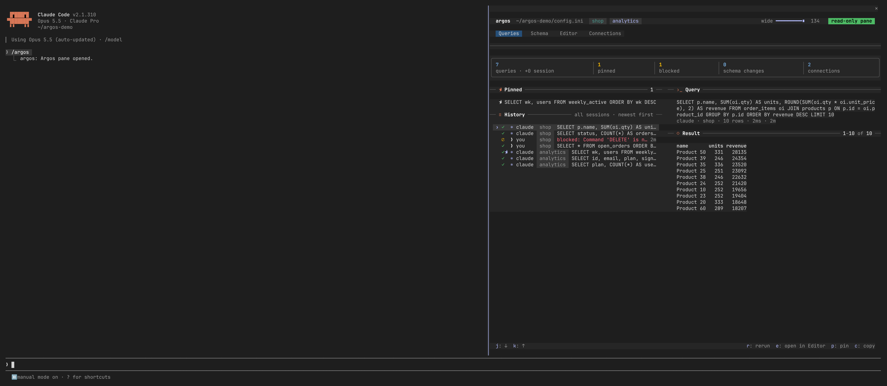
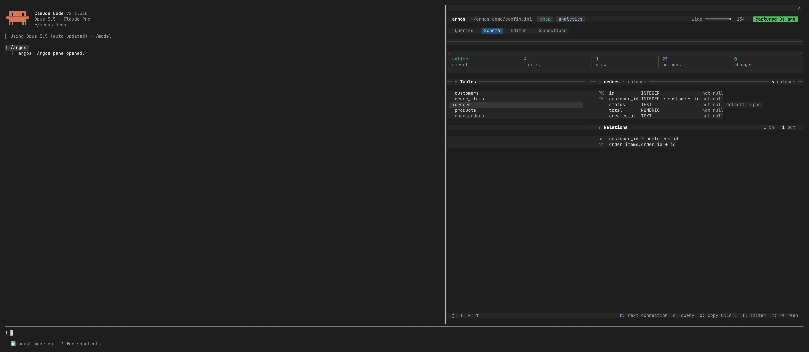
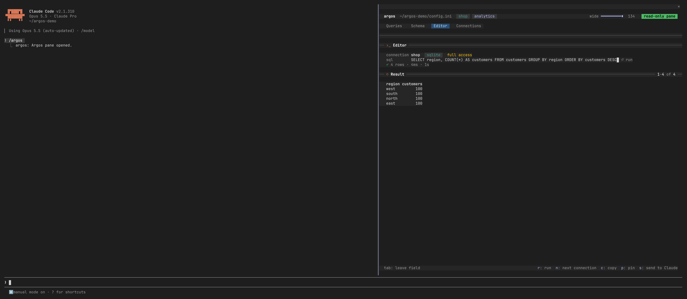
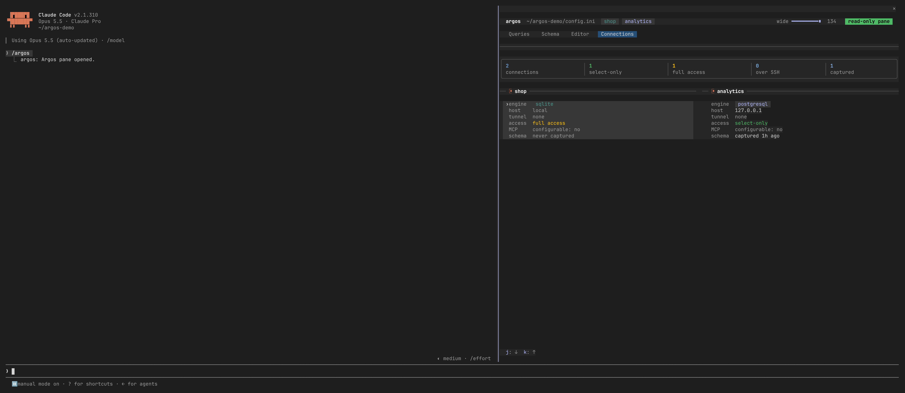

# The Claude Code pane

A pane beside the chat in Claude Code that shows what Argos is doing: your
connections, their schema, and every query Claude runs, plus an Editor to run
your own read-only queries. It is a Claude Code plugin shipped in this
repository (`plugin/`).

## Installing

Build Argos first, since the pane runs the built `argos` CLI:

```bash
npm run build
```

Then preview what the install would do. This writes nothing:

```bash
argos install-plugin
```

When the preview looks right, install:

```bash
argos install-plugin --execute
```

Options:

| Option | Meaning |
|--------|---------|
| `--config <path>` | The `config.ini` the pane reads. Defaults to the one Argos itself would use. It must exist. |
| `--scope user\|project\|local` | Where Claude Code installs the plugin. Defaults to `user`. |
| `--execute` | Do it. Without it you only get the preview. |

The install copies the plugin into a local marketplace under `.plugin/` in the
repository, records the paths of `node`, the built CLI and your config in the
installed copy, and runs `claude plugin marketplace add` and
`claude plugin install argos@argos`. Re-run it after moving the repository or
the config. Restart Claude Code (or start a new session) to load it.

The pane reads the journal in the `.argos/` folder beside the `config.ini` the
install recorded. The Argos MCP server writes Claude's queries to the journal
beside the `config.ini` it was started with, so both must use the same file:
if the server runs with a different config, the pane will not see Claude's
queries.

## Opening it

Type `/argos` in Claude Code to open the pane; type it again to close it. The
plugin's **Open pane on start** option opens it with each session instead, and
**Enabled** turns the pane off.

If the pane says `argos: plugin not installed by argos install-plugin`, the
plugin was installed some other way; run the install above.

## The four tabs

Switch with the tab bar or the digit keys:

| Key | Tab | Shows |
|-----|-----|-------|
| `1` | Queries | Every query run through Argos, newest first, and the selected one's SQL and result |
| `2` | Schema | The tables, columns and relations of a connection |
| `3` | Editor | A field to write and run your own query |
| `4` | Connections | A card per configured database |

The footer bar lists the keys that apply to what is selected. `j` and `k` (the
arrows in the footer) move the selection down and up a list.

### Queries



History is read from the journal and covers all sessions; older entries load as
you reach the end of the list. Entries are marked by who ran them: Claude, or
you from the pane. Claude's queries appear the moment they finish.

| Key | Does |
|-----|------|
| `r` | Rerun the selected query read-only, as a pane query of yours. A query Claude ran with bound parameters cannot be rerun (the journal keeps the SQL, not the values); the pane says so instead |
| `e` | Open its SQL in the Editor |
| `p` | Pin it, or unpin it. A pinned query keeps its result |
| `c` | Copy the result as Markdown; press again within two seconds for CSV, then JSON |
| `s` | Send to Claude (only on queries you ran from the pane) |
| `m` / `b` | The next or earlier page of a long result |

### Schema



Pick a connection and walk its tables. A schema is read once and kept; the pill
in the header says how old it is.

| Key | Does |
|-----|------|
| `n` | Next connection (when you have more than one) |
| `r` | Read the schema from the database again |
| `q` | Open the Editor with a query for a hundred rows of the selected table |
| `c` | Copy the table's `CREATE TABLE` |
| `f` | Filter the tables by name. Enter keeps the filter and closes the field; `f` again clears it |

### Editor



Type SQL and press Enter to run it. The result shows below the field, the first
200 rows. A refused query shows the reason in red, and your SQL stays in the
field. While the field holds the keys, letters and digits type into it; the
footer says `tab: leave field`, and Tab moves out so the hotkeys work again.

| Key | Does |
|-----|------|
| Enter | Run the query in the field |
| `r` | Run (when the field is not focused) |
| `n` | Next connection; your SQL stays |
| `c` | Copy the result (the same Markdown, CSV, JSON cycle), or the SQL before anything ran |
| `p` | Pin it |
| `s` | Send to Claude |

### Connections



One card per database from `config.ini`: type, host, whether it uses an SSH
tunnel or SSL, whether it is SELECT-only, and how old its captured schema is.
Passwords are never shown.

The single-key shortcuts are for the lists. While you type in the Schema filter
or the Editor field, the letters go into the field.

## Pane queries are always read-only

A query you run from the pane, in the Editor or by rerun, goes through the same
SELECT-only check Argos applies to Claude, and it applies even when the
connection itself is configured to allow writes. Anything else is refused with
the reason, and the refusal is recorded in the history.

That check reads the SQL; it cannot know what a function called from a `SELECT`
does (`SELECT setval(...)`, `SELECT lo_unlink(...)`, a volatile function of your
own). So the connections the pane opens are also read-only at the database,
whatever `select_only` says in `config.ini`. What that guarantees depends on
the engine:

| Engine | Below the SELECT-only check | What it does not stop |
|--------|-----------------------------|-----------------------|
| SQLite | The file is opened read-only, so any write fails | Nothing: the file cannot change |
| PostgreSQL | The session is `READ ONLY`, so writes to tables, sequences (`setval`, `nextval`) and large objects (`lo_unlink`) fail | Things that are not writes: advisory locks (`pg_advisory_lock`), signalling other sessions (`pg_cancel_backend`, `pg_terminate_backend`, which need the privilege), and anything outside the database the server lets a function do |
| MySQL / MariaDB | The session is `READ ONLY`, so writes to tables fail | Named locks (`GET_LOCK`), writes to temporary tables, `SLEEP` |
| SQL Server | Nothing: SQL Server has no read-only session setting | Whatever a function called from a `SELECT` does. Only the SELECT-only check applies; for a hard guarantee, connect as a login with read-only permissions |

For a guarantee that holds for every engine, give the connection a database user
that can only read. This applies to the pane only: the MCP server opens its
connections exactly as `config.ini` says.

## Where things are kept

Beside your `config.ini`, in a `.argos/` folder (created private to your user):

| Path | Holds |
|------|-------|
| `.argos/journal.jsonl` | One line per query: when, who ran it, the connection, the SQL, how long, rows, and the outcome |
| `.argos/spool/` | The full result of each query, read back page by page |
| `.argos/pins.json` | Your pins |
| `.argos/schema-checks.json` | When each connection's schema was last checked for changes, so the once-a-minute limit holds across the server and the pane |
| `.argos/.gitignore` | Ignores everything in the folder, so none of it is committed to the repository the config lives in |

Results are kept for up to 30 days and 200 MB in total; past either, the oldest
are removed first. Results of pinned queries are kept regardless. The history
line itself stays, and its result then reads `result no longer kept`: press `r`
to run it again. The journal keeps SQL text, so treat `.argos/` like the config
beside it.

## What Claude is told

Nothing about the pane. Your queries and what you look at stay out of the
conversation unless you press `s`, which places the SQL and a capped table of
the result in your prompt box as a draft (or copies it, if the prompt cannot be
filled) for you to add a question to and send yourself.

The one thing Claude sees from this machinery is what Argos already says in its
own tool results: when a table or column has changed since the schema was last
captured, the result of `sql_query` ends with a `Schema changed since last look:`
line.

## When something fails

The pane never closes over a failure; it says one line and carries on.

| Line | Meaning |
|------|---------|
| `argos: plugin not installed by argos install-plugin` | The install's record is missing; run the install |
| `argos: could not run the argos CLI (...)` | `node` or the built CLI could not start; rebuild or reinstall |
| `argos: the pane could not be drawn (...)` | The pane failed to draw; the reason follows |
| `blocked: ...` | The query was not read-only, or Argos's security check refused it |
| `result no longer kept - r to rerun` | The stored result aged out or was evicted |
| `can't rerun: this query used parameters` | Claude ran it with bound parameter values, which the journal does not keep; open it with `e` and fill them in |
| `result too wide to show here` | A result the pane cannot hold; `c` copies the SQL |
| `output too large` | The CLI's answer was cut short; the pane asks again for fewer rows |

An error from a database shows as `error: ...` on the entry. See the
[troubleshooting guide](../guides/troubleshooting-guide.md) for problems with
the connections themselves.
